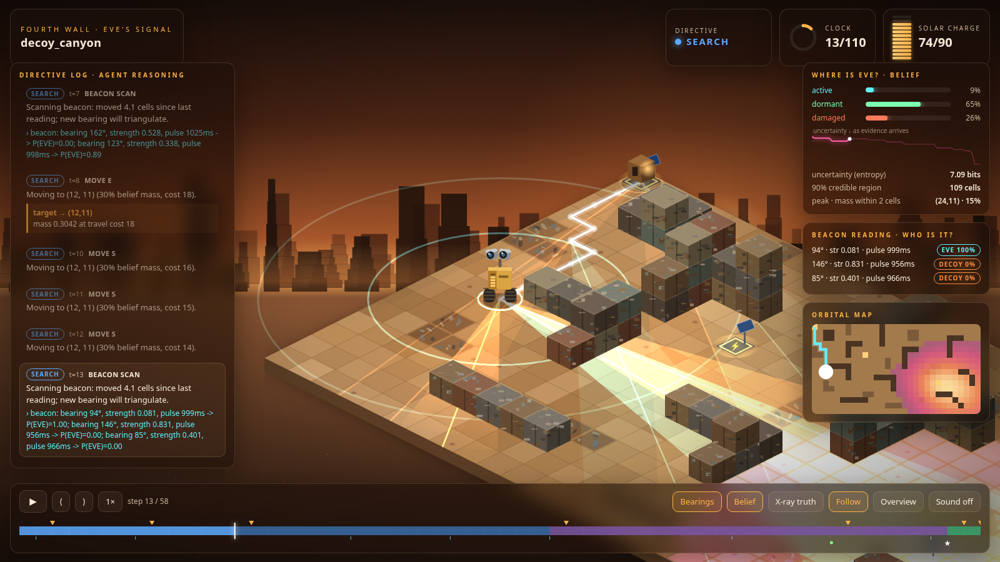
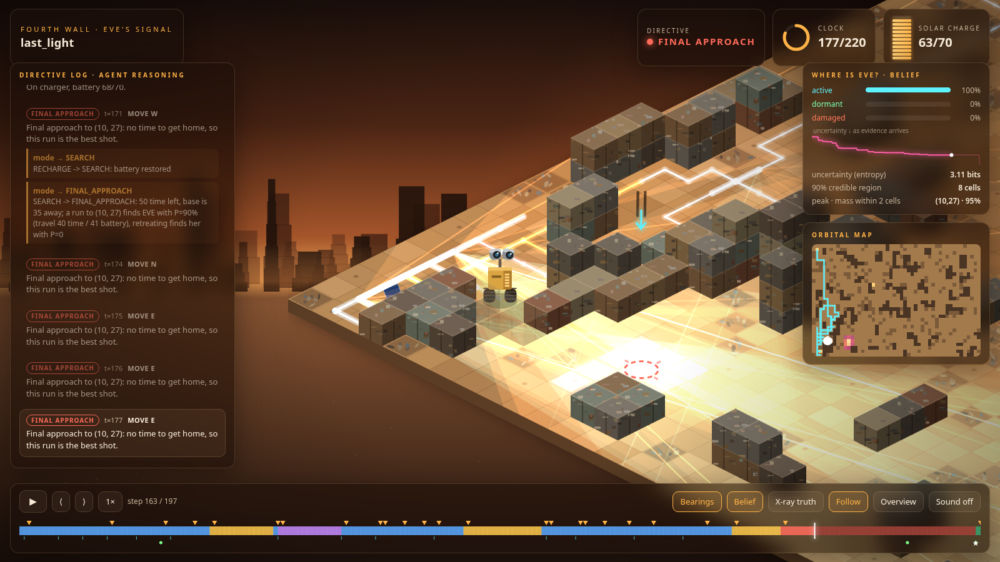

<div align="center">

# EVE's Signal

**An autonomous WALL-E agent that reasons its way to EVE through noise, decoys, a dying battery and a ticking clock.**

### [▶ Watch it live: fourth-wall-nine.vercel.app](https://fourth-wall-nine.vercel.app)

<a href="https://fourth-wall-nine.vercel.app/missions/decoy_canyon.html"></a>

</div>

WALL-E starts with a map, a battery and one faint beacon reading. He has to find EVE, work out whether she is **active, dormant or damaged**, and decide what to do next. Spoofed transmitters, noisy sensors and a hard energy budget stand in his way. He uses no learned model: a **Bayesian belief** over EVE's position × status drives an **energy-safe planner**, and every decision is logged along with its reasoning.

## Quick start

```bash
pip install -r requirements.txt                          # numpy, PyYAML · Python 3.10+
python -m walle run configs/last_light.yaml --open       # run a mission, open the cinematic player
python -m walle bench --n 100                            # benchmark vs baselines
python -m unittest discover -s tests -t .                # tests
```

Each run writes `runs/<mission>/`:

| File | What it is |
|---|---|
| `cinema.html` | **Animated isometric replay.** Self-contained and works offline |
| `report.md` / `report.json` | Outcome, evidence, inferred location and status with confidence, the recommended next move, strategy changes |
| `trace.jsonl` | Every step: state, action, observation, reasoning, belief summary |
| `replay.html`, `path.svg`, `map.txt`, `strategy_frames.txt` | Simpler views |

## How it works

**World.** A grid of open ground, rubble (costly) and trash walls, plus solar chargers. The agent sees the map. It doesn't see EVE, her status, the clues or the decoys.

**Sensors.**
- **Beacon scan:** returns a bearing, strength and pulse interval for each detection. Signal strength and detection rate depend on EVE's status.
- **Decoys:** copy EVE's signature and transmit louder. Only their pulse timing gives them away (±40 ms vs ±4 ms).
- **Area scan:** reveals clues, decoys and EVE nearby. Clues are hover tracks, hull debris, plant residue and memory chips.

**Belief.** A grid filter over `P[status, y, x]`. Beacon readings use a mixture model ("this detection is EVE, the rest are decoys" vs "EVE wasn't detected"), so silence is evidence too. When a decoy is found, the posterior is rebuilt from the full evidence log and old readings are explained away.

**Planner.** Each step, in priority order:
1. **Rendezvous:** if EVE has been sighted, drive to her.
2. **Recharge:** if in recharge mode, stay on the pad until nearly full.
3. **Turn back, or make a final approach:** when the clock runs short, compare P(find EVE) on one last run with retreating (P = 0). Commit if P ≥ 0.25 and the trip fits both time and battery.
4. **Energy guard:** never act unless a charger stays reachable with a safety margin.
5. **Triangulate:** re-scan the beacon after moving a set distance (the baseline), so bearings from different points cross at EVE.
6. **Search:** go where expected belief mass ÷ travel cost is highest. Switch to INVESTIGATE once one area holds ≥ 35% of the belief.

## Results

100 seeded missions per tier, with every agent run on the same maps ([full table](runs/benchmark/benchmark.md)):

| Tier | Belief agent | Greedy | Random | Belief agent stranded |
|---|---|---|---|---|
| easy | **100%** | 69% | 3% | 0% |
| medium | **100%** | 13% | 1% | 0% |
| hard | **100%** | 10% | 0% | 0% |
| extreme | **52%** | 5% | 0% | 0% |

- **Greedy** chases the loudest signal, so decoys mislead it, and it strands itself on 16% of extreme missions.
- **Final approach ablation (extreme tier):** 46% success without the rule, 52% with it, and still no strandings.

## Sample missions

| Mission | Story | Result |
|---|---|---|
| [`sample_mission`](configs/sample_mission.yaml) | Two decoys out-shout EVE | Rejects both on pulse timing; finds active EVE at t=58 · [watch](https://fourth-wall-nine.vercel.app/missions/sample_mission.html) |
| [`decoy_canyon`](configs/decoy_canyon.json) | A loud decoy on the direct route, damaged EVE | Lured briefly, then corrects; recommends towing her to a charger · [watch](https://fourth-wall-nine.vercel.app/missions/decoy_canyon.html) |
| [`last_light`](configs/last_light.yaml) | Extreme tier, 220 ticks | At t=170: *"a run to (10, 27) finds EVE with P=90%, retreating finds her with P=0"*. Reaches her at t=212 · [watch](https://fourth-wall-nine.vercel.app/missions/last_light.html) |



## Cinematic player

The trash-cube wasteland is drawn with the plain canvas API, with no libraries.
- **Belief:** a glowing heatmap.
- **Beacon readings:** bearing cones, cyan for EVE and orange for decoys.
- **EVE:** drawn according to her true status.
- **HUD:** a live reasoning log, battery, clock, status posterior, entropy sparkline, minimap and a scrubbable timeline.

**Keys:** `space` play · `←/→` step · `1–4` speed · `T` X-ray truth · `R` bearings · `H` belief · `O` overview · `S` sound. Link to a moment with `cinema.html#step=120`.

Rebuild the showcase site with `python -m walle site`.

## Layout

```
walle/
  env.py      simulator and hidden state          belief.py   Bayesian grid filter
  agent.py    belief-driven planner               baselines.py greedy and random agents
  world.py    terrain, A*, Dijkstra               runner.py   agent ↔ env loop, trace
  report.py   mission report                      benchmark.py tiers and evaluation
  viz.py      ASCII / SVG / HTML replay           cinema.py   isometric player
  config.py   YAML/JSON loader and defaults       site.py     static showcase site
configs/      sample missions (procedural or hand-drawn)
runs/         committed outputs and benchmark
```

Configs accept procedural maps or hand-drawn grids (`S . # ~ C E`). Every key is optional; defaults are in [`walle/config.py`](walle/config.py).

**Not included:** multi-agent coordination, an LLM-planner comparison, a physics simulator.
